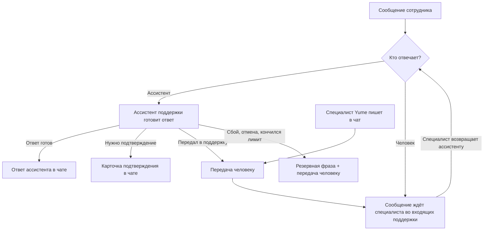

Раздел «Сообщения» — переписка внутри компании и с поддержкой Yume. У каждого сотрудника есть закреплённый **чат с поддержкой**, кроме того, коллеги могут писать друг другу лично и собираться в группы. Сообщение устроено так же, как [комментарий](/ru/logic/attachments/comments): текст, фото, файлы и упоминания записей, — но живёт только внутри переписки и через общий список комментариев не видно.

Раздел — единственная точка входа в поддержку: отдельная страница ассистента поддержки убрана, теперь ассистент отвечает прямо в чате «Поддержка Yume».

Полный перечень полей — в [глоссарии](/ru/logic/chat-glossary).

## Логика

### Виды переписки

| Вид | Кто участвует | Как появляется |
|-----|---------------|----------------|
| Чат с поддержкой | Один сотрудник компании; с другой стороны — ассистент поддержки и специалисты Yume | Создаётся сам при первом открытии списка чатов; у сотрудника он один на компанию |
| Личный чат | Два сотрудника одной компании | Создаётся при первом сообщении коллеге; повторная попытка открывает уже существующий чат, кто бы из двоих её ни начал |
| Групповой чат | Создатель и выбранные им сотрудники компании | Создаётся явно, с необязательным названием |

**Переписка принадлежит компании.** Список чатов показывает только переписки активной компании, в которых пользователь участвует. Пригласить в чат можно только сотрудников этой же компании — попытка добавить человека из другой компании отклоняется.

**Чужую переписку не видно.** Не участник, открывший чат по номеру, получает ответ «не найдено» — так же, как если бы чата не было. Исключение — специалисты поддержки Yume: им открыт любой чат с поддержкой, но не личные и не групповые чаты компании.

### Групповые чаты

- **Добавлять людей** может любой участник группы, как в мессенджерах.
- **Удалять других участников** может только создатель группы или администратор компании. **Выйти** из группы может любой участник в любой момент.
- **Переименовать** и **удалить** группу может только создатель или администратор компании.
- Когда группу покидает последний участник, она удаляется сама — пустых чатов не остаётся.
- Удаление группы удаляет и всю её переписку.
- Состав и название меняются только у групп: у личного чата и чата с поддержкой участников менять нельзя, и удалить их тоже нельзя.

После любого такого изменения участникам уходит сигнал обновить список чатов.

### Сообщения

Сообщение — это текст, фото, файлы и упоминания записей (клиента, аренды, инвентаря и других — тот же общий реестр, что у [комментариев](/ru/logic/attachments/comments#упоминания-записей)). Автор подставляется автоматически из текущего пользователя. Ответ ассистента поддержки — сообщение **без автора** с пометкой «ответ ассистента», чтобы его можно было отличить от сообщения удалённого сотрудника.

**Как отправляется сообщение с вложениями.** Сначала создаётся само сообщение, затем к нему загружаются фото и файлы, и только после этого автор подаёт сигнал «сообщение готово». Если сигнал разослать сразу, собеседник успеет открыть сообщение раньше, чем загрузятся вложения. Подать такой сигнал может только автор сообщения.

**Упоминания сотрудников в сообщениях не рассылают уведомлений.** В комментариях упомянутому коллеге приходит уведомление; в переписке оно было бы лишним — получатель и так получает сообщение.

**История подгружается порциями** по 50 сообщений, начиная с самых новых. Более старые запрашиваются «до такого-то сообщения», а открытый чат при обновлении забирает только то, что пришло после последнего показанного сообщения, — а не всю последнюю страницу заново.

**Отправка сообщения отмечает чат прочитанным для автора.**

### Отметки о прочтении и счётчик непрочитанного

У каждого участника своя отметка о прочтении — момент, до которого он прочитал переписку. Непрочитанными считаются сообщения других участников (и ответы ассистента), пришедшие после этой отметки. Отметка ставится при открытии чата и при отправке своего сообщения.

- В списке чатов у каждой переписки свой счётчик непрочитанного, превью последнего сообщения и время последнего сообщения. Порядок — по времени последнего сообщения, самые свежие выше; чаты, где ещё нет ни одного сообщения, стоят в самом начале.
- Общий счётчик для значка раздела — сумма непрочитанного по всем чатам пользователя в активной компании.
- У специалистов поддержки отдельно считается **число чатов поддержки с непрочитанным**, причём только среди переданных человеку (см. ниже).

Специалисты поддержки не участвуют в чате с поддержкой как участники, поэтому у них одна **общая отметка о прочтении на весь чат**: когда любой специалист открыл чат или ответил в нём, чат считается прочитанным для всей поддержки. Непрочитанными для поддержки считаются только сообщения самого сотрудника компании.

### Сигналы в реальном времени и push

Открытый интерфейс узнаёт о новых сообщениях через канал компании в реальном времени. **По каналу передаются только номера** — чата и получателей, но не текст: подписаться на канал технически может кто угодно, поэтому содержимое переписки по нему не ходит. Получив сигнал, интерфейс сам забирает сообщения обычным запросом с проверкой доступа.

Сигналов два вида:

- **«Новое сообщение»** — уходит всем участникам, кроме автора.
- **«Обновить список»** — после изменения состава, названия или удаления группы, а также после передачи чата с поддержкой человеку или ассистенту.

Параллельно получатели получают **push** на телефон: заголовок — «Поддержка Yume» для чата с поддержкой, название группы для группы, имя автора для личного чата; текст — начало сообщения, где маркеры упоминаний заменены именами. Push идёт напрямую на устройства, зарегистрированные под этой компанией, — без записи в ленту уведомлений и без учёта настроек тем.

Сообщения сотрудника в чате с поддержкой дополнительно сигналят в общий канал поддержки Yume, чтобы её входящие обновились.

### Чат с поддержкой: кто отвечает

У чата с поддержкой есть признак **«кто отвечает»**: ассистент или человек.

**Ассистент отвечает первым.** Новый чат с поддержкой начинается с ассистента. Каждое сообщение сотрудника, пока отвечает ассистент, запускает ассистента поддержки: он работает от имени этого сотрудника, внутри его компании и со всей историей этого чата — одна сессия ассистента на чат. Ответ приходит **целиком**, а не по мере набора: в чат кладётся готовое сообщение, когда ассистент закончил.

**Ассистент видит только текст.** Из сообщения убирается разметка, абзацы становятся строками, упоминания превращаются в имена. Фото и файлы ассистенту не передаются. Сообщение без текста — например, один скриншот — ассистента не запускает.

**Переписка переходит к человеку**, если:

- ассистент сам решил передать вопрос в поддержку (документация не покрывает вопрос или проверки ничего не дали) — специалисты получают сводку в служебный канал, а чат уходит во входящие поддержки;
- запуск ассистента завершился сбоем или был отменён — в чат приходит резервная фраза «Ассистент не смог ответить — здесь ответит специалист поддержки.»; наполовину набранный ответ не публикуется;
- у компании исчерпан лимит ассистента — та же резервная фраза, ассистент не запускается;
- в чат написал специалист поддержки Yume.

После передачи человеку новые сообщения сотрудника ассистента больше не запускают — они ждут специалиста. Ответ запуска, который был уже в работе в момент передачи, всё равно доставляется в чат.

**Вернуть чат ассистенту** может только специалист поддержки — отдельным действием в чате. У сотрудника компании такой кнопки нет.

**Чат, который открыл сам специалист поддержки,** начинается с человека: поддержка написала первой, значит и отвечать дальше ей. Если у сотрудника чат с поддержкой уже был, специалист попадает в него же.

**Ответы ассистента тратят лимит ассистента компании** — тот же, что и обычный чат с ассистентом.

### Подтверждение действий в чате

Если ассистент хочет что-то изменить в данных компании (например, включить настройку), он не делает этого сам, а присылает в чат **карточку подтверждения**: что именно он собирается сделать, с выбором — подтвердить или отклонить. Решение сотрудника запускает продолжение, и ответ продолжения приходит следующим сообщением, а карточка помечается решённой — с тем, что было подтверждено и что отклонено, — чтобы не спрашивать повторно.

Если сотрудник не ответил на карточку, а просто написал следующее сообщение, все ожидавшие карточки считаются **отклонёнными**: кнопки исчезают, карточка показывает отказ.

### Входящие поддержки Yume

Специалисты поддержки — сотрудники Yume с правами поддержки на всей платформе — видят общие входящие по всем компаниям.

- По умолчанию во входящих только чаты, **переданные человеку**: остальное ведёт ассистент. Можно показать чаты, которые ведёт ассистент, или все сразу.
- Во входящие попадают только чаты, где есть хотя бы одно сообщение.
- Фильтры: по компании и поиск по имени, фамилии, телефону сотрудника или названию компании. Список постраничный.
- Специалист может сам начать чат с поддержкой с любым сотрудником компании. Обычному сотруднику создать чат поддержки с коллегой нельзя.

**Отвечают изнутри компании.** Открыть переписку специалист может только находясь в той же компании, что и чат. Из другой компании сервер отвечает конфликтом и сообщает, в какую компанию нужно переключиться. Это же правило действует для всех: переписка открывается только в своей компании.

### Чего не делает ассистент

Инструмент ассистента для работы с данными компании не может обращаться к разделу «Сообщения» ни на чтение, ни на запись: сообщения пишет человек человеку. Ассистент поддержки отвечает только в своём чате с поддержкой.

### Связь с комментариями

Сообщения хранятся как комментарии, привязанные к переписке, но общий раздел комментариев их не показывает и не принимает:

- список комментариев и обращения к отдельному комментарию не видят сообщений чата;
- попытка создать сообщение чата через общий раздел комментариев отклоняется с ошибкой «Сообщения чата отправляются через чат».

## Подводные камни

<Warning>
**Сообщение без текста в чате с ассистентом остаётся без ответа.** Если сотрудник отправил только скриншот или файл, ассистент не запускается, а чат не передаётся человеку. Во входящих поддержки по умолчанию такой чат не виден, а счётчик поддержки его не считает, — сообщение может провисеть без внимания, пока сотрудник не допишет текст.
</Warning>

<Warning>
**Если ассистента не удалось запустить по причине, отличной от лимита, сотрудник не получает ничего.** Сбой при старте записывается в журнал ошибок, но резервная фраза не публикуется и чат не передаётся человеку. Резервная фраза и передача гарантированы только для исчерпанного лимита и для запуска, который начался и потом завершился сбоем или отменой.
</Warning>

<Warning>
**Отметка о прочтении у поддержки одна на всех специалистов.** Как только один специалист открыл чат, он перестаёт быть непрочитанным для всей поддержки. Распределять чаты между специалистами по признаку «прочитано» нельзя.
</Warning>

<Warning>
**Чат с поддержкой под ассистентом не виден во входящих по умолчанию и не входит в счётчик поддержки**, даже когда в нём есть непрочитанные сообщения. Специалист узнаёт о таком чате, только если включит показ чатов ассистента или чат будет передан человеку.
</Warning>

Менее критичные особенности:

- Удаление группы убирает её сообщения, но файлы из сообщений остаются в облачном хранилище.
- Личный чат ищется перед созданием, а не защищён ограничением базы: при двух одновременных попытках у одной пары сотрудников теоретически могут появиться два личных чата.
- Push о сообщении приходит только на устройства, зарегистрированные под компанией этого чата. Сотрудник нескольких компаний не получит push, если его приложение зарегистрировано под другой компанией.
- Повторная передача в поддержку по инициативе ассистента в течение 15 минут не повторяется: ассистент сообщит, что поддержка уже занимается вопросом.
- Участник, удалённый из группы, теряет доступ ко всей её истории, включая собственные сообщения.
